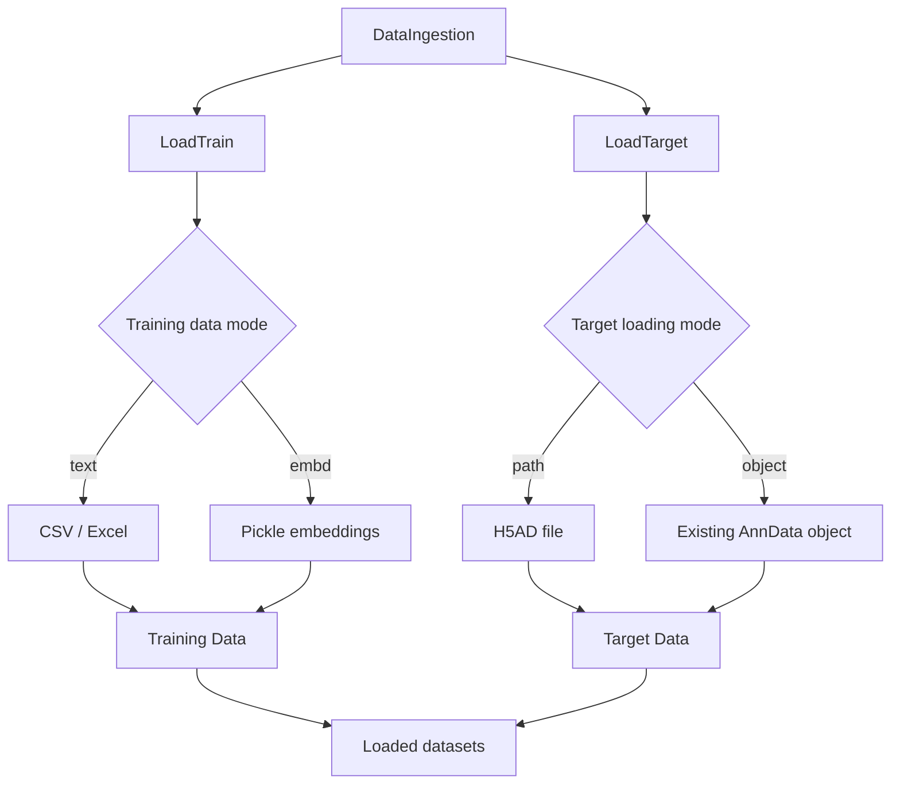

# GenePert V2 – Technical Design Document

## 1. Data Ingestion

**Status:** Implemented

### 1.1 Description

The Data Ingestion module is responsible for loading the training and target datasets from different sources and file formats.

It provides an interface for loading dataset while delegating the actual loading operations to dedicated loader classes.

The module currently supports two types of training data:

- **Precomputed embeddings:** Gene embeddings stored in Pickle files.
- **Gene descriptions:** Raw gene descriptions stored in CSV or Excel files.

The target dataset is loaded as an AnnData object containing gene expression data and associated metadata.

### 1.2 Workflow

The ingestion process starts with the `DataIngestion` class, which coordinates the loading of both datasets.

It delegates each loading operation to its corresponding loader:

1. `LoadTrain` handles the training data.
   - If the selected mode is `text`, gene descriptions are loaded from CSV or Excel files.
   - If the selected mode is `embd`, precomputed embeddings are loaded from Pickle files.

2. `LoadTarget` handles the target dataset.
   - Loads an existing AnnData object or reads an H5AD file from a given path.

3. Once both loading operations are completed, the datasets are stored in the `DataIngestion` instance and made available to subsequent pipeline stages.

**Workflow overview:**

### 1.3 Inputs

The module requires two main inputs:

**Training data**

The training dataset can be provided in either of the following formats:

- CSV or Excel files containing gene identifiers, labels, and descriptions.
- Pickle files containing precomputed gene embeddings.

The loading mode is controlled through the `train_mode` parameter:

- `text`: Loads gene descriptions into a Pandas DataFrame.
- `embd`: Loads precomputed embeddings.

**Target data**

The target dataset is expected to be an AnnData object containing gene expression measurements and associated metadata.

It can be provided in two ways:

- `path`: Loads an AnnData dataset from an H5AD file.
- `object`: Accepts an already existing AnnData object.

### 1.4 Outputs

After successful ingestion, the module exposes the loaded datasets through the following attributes:

- `train_data`: Contains the loaded gene descriptions or precomputed embeddings.
- `target_data`: Contains the target AnnData dataset.
- `train_data_type`: Records the selected training data mode.

The `load()` method returns the `DataIngestion` instance, allowing subsequent pipeline stages to access the loaded data.

### 1.5 Current Implementation

The current implementation uses:

- **Pandas** to read CSV and Excel files.
- **Pickle** to load precomputed embeddings.
- **Scanpy** to read H5AD datasets.

Basic input validation is performed:

- Checks whether the input files exist.
- Checks whether the provided file extensions are supported.
- Raises exceptions for unsupported loading modes or file formats.

### 1.6 Future Enhancements

The following improvements could make the ingestion stage more robust and flexible:

- **Input validation:** Validate the structure of gene-description files and ensure required columns are present.
- **Embedding validation:** Check embedding dimensions, data types, and gene identifiers before passing them to subsequent stages.
- **Data consistency:** Validate gene identifiers across training and target datasets to ensure they can be matched correctly.
- **Error handling:** Improve error messages and provide more informative feedback when loading fails.
- **Logging:** Replace print statements with structured logging to improve monitoring and debugging.
- **Extensibility:** Support additional input formats and embedding sources.

**Implementation note:**

Although `LoadTarget` supports both file-based and in-memory AnnData loading, the current `DataIngestion.load()` method only exposes file-based loading. Supporting both options directly through the main ingestion interface would improve flexibility.

## 1.7 Data Types and Object Structure

The Data Ingestion module produces two main objects: `train_data` and `target_data`.

### Training Data (`train_data`)

The data type depends on the selected loading mode.

**Mode: `text`**

- Python type: `pandas.DataFrame`
- Source: CSV or Excel file.
- Expected content:
  - Gene identifier
  - Gene label (if available)
  - Gene description

**Mode: `embd`**

- Python type: Depends on the serialized object stored in the Pickle file.
- Source: PKL / PICKLE file.
- Expected content: Precomputed gene embeddings associated with gene identifiers.

**Note:** The current implementation does not enforce a specific structure or data type for the loaded embeddings.

### Target Data (`target_data`)

- Python type: `anndata.AnnData`
- Source: H5AD file or an existing AnnData object.
- Main components:
  - `X`: Expression matrix, typically a NumPy array or sparse matrix.
  - `obs`: `pandas.DataFrame` containing cell-level metadata.
  - `var`: `pandas.DataFrame` containing gene-level metadata.
  - `obs_names`: Cell identifiers.
  - `var_names`: Gene identifiers.

### Data Ingestion Attributes

The `DataIngestion` class maintains the following attributes:

- `train_data`
  - Type: `pandas.DataFrame` or loaded embedding object.
  - Stores the training input data.

- `target_data`
  - Type: `anndata.AnnData`.
  - Stores the target gene expression dataset.

- `train_data_type`
  - Type: `str`.
  - Values: `"text"` or `"embd"`.
  - Records the selected training data mode.

- `train_loader`
  - Type: `LoadTrain`.
  - Responsible for loading training data.

- `target_loader`
  - Type: `LoadTarget`.
  - Responsible for loading target data.

### Type Validation Considerations

Future implementations should enforce:

- Consistent gene identifier types across training and target data.
- A clearly defined structure for precomputed embeddings.
- Numeric embedding values.
- Consistent embedding dimensions across genes.
- A valid AnnData expression matrix with identifiable genes and cells.
