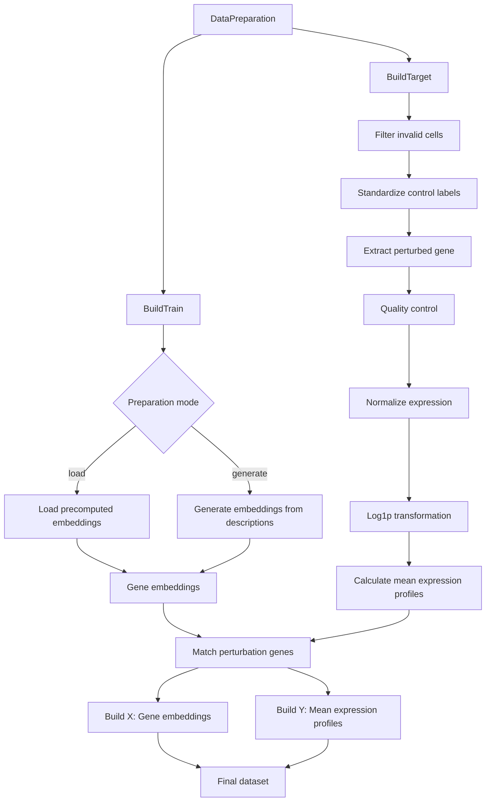

## 2. Data Preparation

**Status:** Partially Implemented

### 2.1 Description

The Data Preparation module is responsible for transforming the ingested training and target data into a format suitable for model training.

It consists of two main components:

- **BuildTrain:** Prepares the training data by loading precomputed gene embeddings or generating embeddings from gene descriptions.
- **BuildTarget:** Preprocesses the gene expression dataset, performs quality control and normalization, and calculates mean expression profiles for each perturbation.

The `DataPreparation` class coordinates both components and combines their outputs into a unified dataset.

The final dataset consists of:

- **X:** Gene embeddings representing the perturbed genes.
- **Y:** Mean gene expression profiles corresponding to each perturbation.

### 2.2 Workflow

The preparation process starts with the `DataPreparation` class, which coordinates the preparation of training and target data.

It delegates each operation to its corresponding builder.

1. `BuildTrain` prepares the training data.
   - In `load` mode, precomputed embeddings are used directly.
   - In `generate` mode, gene descriptions are intended to be converted into embeddings using a selected embedding model. This functionality is not yet implemented.

2. `BuildTarget` processes the target AnnData dataset.
   - Filters cells without valid perturbation labels.
   - Standardizes control perturbation labels.
   - Extracts the perturbed gene identifier.
   - Performs quality control by filtering genes and cells.
   - Normalizes gene expression values.
   - Applies log1p transformation.
   - Calculates the mean expression profile for each perturbation.

3. `DataPreparation` combines the resulting embeddings and expression profiles.
   - Matches perturbation genes with their corresponding embeddings.
   - Constructs X from the matched gene embeddings.
   - Constructs Y from the corresponding mean expression profiles.
   - Combines X and Y into the final dataset.

**Workflow overview:**

### 2.3 Inputs

The module requires two main inputs.

**Training data**

The training data is obtained from the Data Ingestion module and can be provided in two forms:

- Precomputed gene embeddings.
- Gene descriptions containing gene identifiers and textual descriptions.

The preparation mode is controlled through the `train_mode` parameter:

- `load`: Uses precomputed embeddings.
- `generate`: Intended to generate embeddings from gene descriptions using an embedding model.

An optional `train_model` parameter allows an embedding model to be provided when using generation mode.

**Target data**

The target dataset is an AnnData object containing gene expression measurements and associated cell-level metadata.

The preprocessing pipeline relies on the following metadata:

- `perturbation`: Original perturbation labels used to identify the genetic perturbation associated with each cell.
- `pert`: Extracted perturbation identifier used to group cells and calculate mean expression profiles.

### 2.4 Outputs

The main output is a combined Pandas DataFrame containing the gene embeddings and corresponding mean expression profiles.

The `DataPreparation` class maintains the following attributes:

- `train_data`: Prepared gene embeddings.
- `target_data`: Mean gene expression profiles grouped by perturbation.
- `ctrl`: Mean expression profiles associated with control cells.
- `dataset`: Final combined dataset containing X and Y.

The `build_dataset()` method returns the final dataset.

**Dataset structure:**

The final dataset consists of two main parts:

- **X (Input features):**
  - `pert`: Gene identifier associated with the perturbation.
  - `embedding`: Embedding vector representing the perturbed gene.

- **Y (Target values):**
  - Mean expression values for all genes in the dataset.
  - Each row corresponds to a perturbation.
  - Each column represents a gene.

Only perturbations with matching gene identifiers in both the embedding collection and target expression profiles are included. This part needs modifications or reporting mechanism which genes are dropped.

### 2.5 Current Implementation

**BuildTrain**

The current implementation supports loading precomputed embeddings.

- Accepts embeddings from the Data Ingestion module.
- Stores the embeddings for subsequent dataset construction.
- Defines a separate generation workflow, but its functionality is not yet implemented.

**BuildTarget**

The target preprocessing pipeline is currently implemented and includes the following operations:

1. **Cell filtering:** Removes cells with missing or unassigned perturbation labels (`*`).
2. **Control formatting:** Maps predefined control labels to a standardized `ctrl` label.
3. **Perturbation extraction:** Extracts the perturbed gene identifier from the original perturbation label by splitting on `_`.
4. **Quality control:** Filters genes based on a minimum of 5 cells and cells based on a minimum of 200 counts.
5. **Normalization:** Normalizes total counts per cell using a target sum of 1,000,000 by default.
6. **Log transformation:** Applies a log1p transformation to the normalized expression values.
7. **Mean expression calculation:** Groups cells by their perturbation identifier and calculates the mean expression profile for each group.

**Dataset construction**

After preparing X and Y:

- Finds the common gene identifiers between the embedding collection and target expression profiles.
- Creates an input DataFrame containing gene identifiers and their corresponding embeddings.
- Selects the matching expression profiles from Y.
- Combines both DataFrames horizontally using Pandas concatenation.

### 2.6 Future Enhancements

The following improvements would make the preparation stage more robust, flexible, and configurable.

**Training data preparation**

- **Embedding generation:** Implement the embedding generation workflow using a selected pretrained embedding model.
- **Model initialization:** Implement the `load_model()` method to load or initialize the selected embedding model.
- **Embedding validation:** Implement validation for embedding dimensions, numeric values, and gene identifiers.
- **Input handling:** Fix and complete the gene-description loading workflow so descriptions are correctly passed to the embedding generation process.
- **Embedding consistency:** Ensure that generated and precomputed embeddings follow the same output structure.

**Target data preparation**

- **Configurable preprocessing:** Allow preprocessing parameters such as minimum cell counts, minimum gene counts, normalization strategy, and target sum to be configured externally.
- **Control handling:** Make control label mapping configurable instead of relying on predefined labels.
- **Perturbation parsing:** Improve perturbation identifier extraction to support different perturbation naming conventions.
- **Quality control:** Investigate additional QC metrics and filtering strategies.
- **Memory efficiency:** Investigate alternatives to converting the entire AnnData expression matrix into a dense Pandas DataFrame when calculating mean expression profiles.

**Dataset construction**

- **Data validation:** Validate that embeddings and target expression profiles have compatible gene identifiers.
- **Missing genes:** Provide information about genes that are missing from either the embedding collection or target dataset.
- **Embedding structure:** Explicitly validate that the embedding collection supports gene-based lookup.
- **Dataset integrity:** Ensure that X and Y have matching rows and that their perturbation identifiers remain aligned.
- **Control data:** Define how control expression profiles should be used in subsequent training stages.
- **Data splitting:** Consider adding a dedicated mechanism for splitting the prepared dataset into training, validation, and test sets, if required by the training strategy.
- **Data quality report:** Generate a report with the provided data quality.

### 2.7 Data Types and Object Structure

The Data Preparation module receives objects from Data Ingestion, transforms them, and produces a combined dataset.

**Training Data (`train_data`)**

The expected structure depends on the preparation mode.

**Mode: `load`**

- Python type: Expected to be a dictionary-like object.
- Keys: Gene identifiers (`str`).
- Values: Embedding vectors, typically NumPy arrays.
- The current implementation does not enforce this structure but relies on dictionary-like operations such as `.keys()` and gene-based lookup.

**Mode: `generate`**

- Input: `pandas.DataFrame` containing gene descriptions.
- Expected output: Dictionary-like object containing gene identifiers and their generated embedding vectors.
- Status: Not implemented.

**Target Data (`target_data`)**

- Python type: `pandas.DataFrame`.
- Generated from: AnnData expression matrix.
- Index: Perturbation identifiers (`str`).
- Columns: Gene identifiers (`str`).
- Values: Mean normalized and log-transformed gene expression values (`float`).

**Control Data (`ctrl`)**

- Python type: `pandas.DataFrame`.
- Generated from: `target_data`.
- Contains: Mean expression profiles for the standardized control perturbation (`ctrl`).
- Index: Default integer index after resetting the original index.
- Includes: The `pert` column identifying the control group.

**Final Dataset (`dataset`)**

- Python type: `pandas.DataFrame`.
- Generated by combining X and Y horizontally.

Its structure consists of:

- `pert`: Gene identifier associated with the perturbation (`str`).
- `embedding`: Embedding vector (`numpy.ndarray` or equivalent vector object).
- Remaining columns: Mean expression values for individual genes (`float`).

**Intermediate Objects**

- `common`: Python `list` containing sorted gene identifiers (`str`) shared between the embedding collection and target expression profiles.
- `X`: `pandas.DataFrame` containing perturbation identifiers and embedding vectors.
- `Y`: `pandas.DataFrame` containing the corresponding mean expression profiles.

**Type Validation Considerations**

Future implementations should enforce:

- Consistent gene identifier types across embeddings and target expression profiles.
- Consistent embedding dimensions across all genes.
- Numeric values in embedding vectors.
- Numeric expression values in Y.
- Matching perturbation identifiers and row ordering between X and Y.
- A clearly defined representation of embedding vectors in the final dataset.
