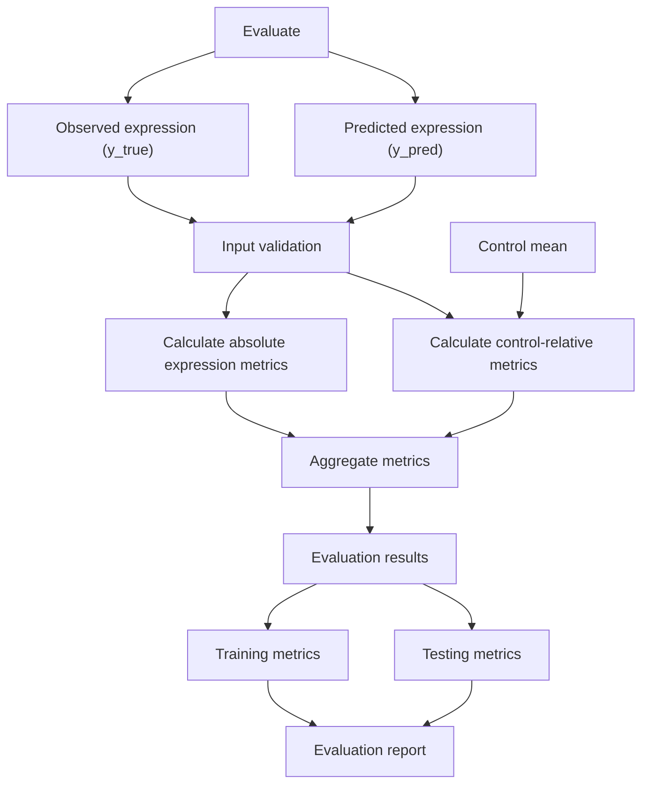

## 4. Evaluation

**Status:** Partially Implemented

### 4.1 Description

The Evaluation module is responsible for assessing model performance by comparing predicted gene expression profiles against experimentally observed expression profiles.

It provides a configurable evaluation interface that calculates multiple regression and correlation metrics.

The current implementation evaluates model predictions from two perspectives:

- **Absolute expression evaluation:** Measures the difference and correlation between predicted and observed gene expression values.
- **Control-relative evaluation:** Measures the correlation between predicted and observed expression changes relative to the control expression profile.

The module also supports evaluating both training and testing predictions through a single reporting interface.

The long-term objective is to develop this module into a comprehensive evaluation framework that supports model grading, performance comparison, and visual reporting.

### 4.2 Workflow

The evaluation process is managed by the `Evaluate` class.

1. **Initialization**
   - Receives the mean control expression profile.
   - Defines the metrics to be calculated.
   - Uses a default set of five evaluation metrics if none are provided.

2. **Input validation**
   - Converts observed and predicted values into NumPy arrays.
   - Ensures both arrays have matching dimensions.
   - Checks that the inputs are two-dimensional.

3. **Metric calculation**
   - Calculates the selected metrics for each perturbation.
   - Aggregates the results by calculating the mean across perturbations.

4. **Control-relative evaluation**
   - Subtracts the control expression profile from both observed and predicted expression values.
   - Calculates Pearson correlation between the resulting expression changes.

5. **Reporting**
   - Evaluates training predictions.
   - Evaluates testing predictions.
   - Returns the results in a structured dictionary.

**Workflow overview:**



### 4.3 Inputs

The module requires the following inputs:

**Control Mean**

The mean expression profile of the control cells, obtained from the Data Preparation module.

It is used as a reference when calculating control-relative expression changes.

**Observed Expression (`y_true`)**

- Contains experimentally observed mean expression profiles.
- Each row corresponds to a perturbation.
- Each column represents a gene.
- Expected to have the same structure and ordering as the corresponding predictions.

**Predicted Expression (`y_pred`)**

- Contains gene expression profiles predicted by the trained model.
- Each row corresponds to a perturbation.
- Each column represents a predicted gene expression value.
- Must have the same shape as the observed expression data.

**Evaluation Configuration**

The `Evaluate` class accepts an optional list of metrics.

The default metrics are:

- `mse`
- `rmse`
- `mae`
- `pearson`
- `pearson_delta`

### 4.4 Outputs

The module produces evaluation results in the form of Python dictionaries.

**Individual Evaluation**

The `evaluate()` method returns a dictionary containing the selected metrics and their corresponding values.

Example structure:

```python
{
    "mse": 0.12,
    "rmse": 0.35,
    "mae": 0.21,
    "pearson": 0.78,
    "pearson_delta": 0.65
}
```

The values above are illustrative.

**Evaluation Report**

The `report()` method evaluates both training and testing predictions and returns:

```python
{
    "train": {
        "mse": ...,
        "rmse": ...,
        "mae": ...,
        "pearson": ...,
        "pearson_delta": ...
    },
    "test": {
        "mse": ...,
        "rmse": ...,
        "mae": ...,
        "pearson": ...,
        "pearson_delta": ...
    }
}
```

### 4.5 Current Implementation

The current implementation includes five evaluation metrics.

**Regression Metrics**

- **Mean Squared Error (MSE):** Measures the average squared difference between predicted and observed expression values. Lower values indicate better performance.
- **Root Mean Squared Error (RMSE):** Calculates the square root of MSE. It expresses prediction error in the original expression scale. Lower values indicate better performance.
- **Mean Absolute Error (MAE):** Measures the average absolute difference between predicted and observed expression values. Lower values indicate better performance.

**Correlation Metrics**

- **Pearson Correlation:** Measures the linear correlation between predicted and observed expression profiles across genes for each perturbation. Higher values indicate stronger correlation.
- **Pearson Delta:** Measures Pearson correlation between predicted and observed expression changes relative to the control mean. It evaluates how well the model captures expression changes rather than absolute expression levels.

**Metric Aggregation**

The current implementation calculates each metric separately for every perturbation and then averages the results across all perturbations.

For Pearson-based metrics, rows with fewer than two values or zero variance return `NaN`.

**Evaluation Reporting**

The `report()` method provides a unified interface for calculating metrics on both training and testing datasets.

### 4.6 Future Enhancements

The Evaluation module is expected to evolve into a more comprehensive model assessment framework.

**Evaluation Metrics**

- **Additional regression metrics:** Investigate metrics such as R-squared and explained variance.
- **Gene-level evaluation:** Calculate metrics separately for individual genes to identify genes that are consistently difficult to predict.
- **Perturbation-level evaluation:** Preserve individual metric results for each perturbation instead of returning only their average.
- **Control-relative error metrics:** Introduce MSE, RMSE, and MAE calculated on expression changes relative to the control profile.
- **Metric aggregation:** Support different aggregation strategies, such as mean, median, and weighted averages.
- **Robustness:** Handle NaN and infinite values consistently across all metrics.

**Model Grading and Comparison**

- **Model grading:** Introduce a grading mechanism that translates evaluation results into an interpretable model performance score.
- **Performance thresholds:** Define configurable thresholds for different metrics.
- **Model comparison:** Compare multiple models using the same evaluation dataset and metrics.
- **Metric weighting:** Allow different metrics to contribute with configurable importance to an overall score.
- **Experiment comparison:** Compare performance across different model configurations and training experiments.

**Visualization and Reporting**

- **Metric visualization:** Display evaluation metrics using charts and summary plots.
- **Predicted vs. observed:** Create scatter plots comparing predicted and experimentally observed expression values.
- **Gene-level visualization:** Visualize prediction errors across individual genes.
- **Perturbation-level visualization:** Identify perturbations with the highest and lowest prediction performance.
- **Expression profiles:** Plot predicted and observed expression profiles for selected perturbations.
- **Control-relative visualization:** Visualize predicted and observed expression changes relative to controls.
- **Evaluation reports:** Generate structured reports containing metrics, visualizations, and model comparisons.

**Architecture and Extensibility**

- **Metric registry:** Introduce a modular mechanism for registering and selecting evaluation metrics.
- **Evaluation configuration:** Allow metric selection and aggregation strategies to be configured externally.
- **Separate visualization component:** Keep visualization and plotting logic independent from metric calculation.
- **Reporting component:** Separate evaluation calculations from report generation.
- **Model independence:** Ensure the evaluation module can work with predictions from both classical ML and deep learning models.

### 4.7 Data Types and Object Structure

The Evaluation module receives observed and predicted expression profiles and returns aggregated evaluation metrics.

**Control Mean (`control_mean`)**

- Python type: `numpy.ndarray`.
- Data type: `float`.
- Expected shape: `(n_genes,)`.
- Contains the mean expression value for each gene in the control group.

**Observed Expression (`y_true`)**

- Input type: Array-like.
- Converted type: `numpy.ndarray`.
- Data type: `float`.
- Expected shape: `(n_perturbations, n_genes)`.

**Predicted Expression (`y_pred`)**

- Input type: Array-like.
- Converted type: `numpy.ndarray`.
- Data type: `float`.
- Expected shape: `(n_perturbations, n_genes)`.

**Evaluation Metrics (`metrics`)**

- Python type: `list`.
- Elements: `str`.
- Contains the names of the metrics to calculate.

**Individual Metric Results**

- Python type: `float`.
- Represents the mean metric value across perturbations.
- May contain `NaN` for Pearson-based metrics when correlation cannot be calculated.

**Evaluation Results**

- Python type: `dict`.
- Keys: Metric names (`str`).
- Values: Metric scores (`float`).

**Evaluation Report**

- Python type: `dict`.
- Top-level keys: `"train"` and `"test"`.
- Values: Dictionaries containing the corresponding evaluation metrics.

### 4.8 Implementation Considerations

The following points should be considered when extending the current implementation:

- The control mean shape validation is currently commented out. It should be enabled to ensure one control expression value exists for every target gene.
- The evaluation currently averages metrics across perturbations, which can hide large differences in performance between individual perturbations.
- Pearson correlation is calculated across genes within each perturbation, not across all observations globally.
- Pearson correlation returns `NaN` for constant expression profiles or profiles with fewer than two genes.
- The current implementation does not explicitly handle NaN or infinite values in the input arrays.
- The `report()` method assumes that the supplied training and testing predictions are correctly aligned with their corresponding observed values.
- Control-relative evaluation currently uses Pearson correlation only.
- No overall grading mechanism or visualization functionality is currently implemented.
- The current implementation does not preserve individual perturbation-level evaluation results.
