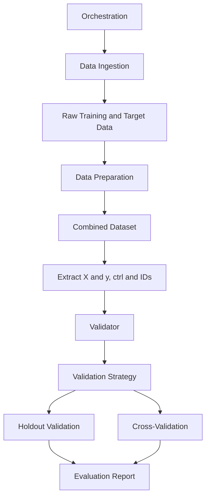

## 5. Orchestration

**Status:** Implemented – Initial Version with Validation Integration

### 5.1 Description

The Orchestration module is responsible for coordinating the different components of the GenePert pipeline and managing the execution of the complete workflow.

It connects the Data Ingestion, Data Preparation, Training, Validation and Evaluation modules into a single execution process.

The current implementation provides a central entry point that takes the input data paths, executes each pipeline stage sequentially, and produces an evaluation report.

The module is designed to keep the individual components independent while managing the flow of data between them.

### 5.2 Workflow

The pipeline execution is managed by the `Orch` class through its `run()` method.

1. **Initialization**
   - Receives the paths to the training and target datasets.
   - Receives the model and validation configuration.
   - Initializes the Data Ingestion, Data Preparation, Trainer and Validator components.

2. **Data Ingestion**
   - Loads the training data and target data.
   - Stores the raw training and target datasets.

3. **Data Preparation**
   - Passes the raw datasets to the Data Preparation module.
   - Builds the combined dataset containing embeddings and mean gene expression profiles.

4. **Data Formatting**
   - Extracts the embedding vectors into the feature matrix `X`.
   - Extracts the gene expression profiles into the target matrix `y`.
   - Converts both matrices into NumPy arrays.
   - Extracts the control expression profile and perturbation identifiers.

5. **Validation**
   - Passes the processed matrices, control expression profile, and perturbation identifiers to the Validator.
   - Executes the selected validation strategy.
   - Delegates data splitting, model training, prediction, and evaluation to the Validation module.

6. **Reporting**
   - Stores the evaluation results.
   - Prints and returns the final evaluation report.

**Workflow overview:**

### 5.3 Inputs

The Orchestration module receives the following inputs:

**Training Data Path (`train_data_path`)**

- Path to the training dataset.
- Contains either precomputed gene embeddings or gene descriptions, depending on the selected ingestion mode.

**Target Data Path (`target_data_path`)**

- Path to the target AnnData dataset.
- Contains the gene expression matrix and associated cell metadata.

**Model (`model`)**

- Name of the model to be used for training.
- Defaults to `"ridge"`.

**Model Parameters (`params`)**

- Contains model-specific configuration parameters.
- Defaults to `None`.
- Passed to the Trainer during initialization.

**Validation Method (`validation_method`)**

- Defines the validation strategy.
- Supports `"holdout"` and `"cross_validation"`.
- Defaults to `"holdout"`.

**Number of Splits (`n_splits`)**

- Number of folds used during cross-validation.
- Defaults to `5`.

**Shuffle (`shuffle`)**

- Determines whether the data is shuffled before generating cross-validation folds.
- Defaults to `True`.

**Random State (`random_state`)**

- Controls reproducibility of internally generated data partitions.
- Defaults to `42`.

**Shared Folds (`folds`)**

- Optional argument passed to the `run()` method.
- Allows multiple cross-validation experiments to use identical training and testing partitions.
- Defaults to `None`.

### 5.4 Outputs

The Orchestration module stores the intermediate datasets, and final evaluation report as attributes of the `Orch` class.

**Raw Data**

- `X_raw`: Raw training data loaded through Data Ingestion.
- `y_raw`: Raw target data loaded through Data Ingestion.

**Processed Data**

- `X_processed`: Processed embedding matrix.
- `y_processed`: Processed gene expression matrix.

**Evaluation Report**

- `report`: Dictionary containing the evaluation results returned by the Validation module.
- Holdout validation returns training and testing metrics.
- Cross-validation returns individual fold results and aggregated metrics.
- The report is also returned by the `run()` method.

### 5.5 Current Implementation

The current implementation connects the main pipeline components and executes them sequentially through a single `run()` method.

**Data Ingestion**

The `DataIngestion` component loads the training and target datasets using their respective paths.

The resulting datasets are stored as `X_raw` and `y_raw`.

**Data Preparation**

The raw datasets are passed to the `DataPreparation` component, which builds the combined dataset.

The resulting dataset contains:

- Perturbation identifiers.
- Gene embedding vectors.
- Mean gene expression values for each perturbation.

**Feature and Target Extraction**

The combined dataset is converted into two NumPy arrays:

- **X:** Created by stacking the embedding vectors using `np.stack()`.
- **y:** Created by removing the perturbation identifier and embedding columns, then converting the remaining gene expression values into a NumPy array.

The control expression profile and perturbation identifiers are also extracted from the prepared data.

**Validation**

The processed matrices, control expression profile, and perturbation identifiers are passed to the Validator component.

The Validator selects the appropriate validation strategy and manages data splitting, model training, prediction, and evaluation through the existing Trainer and Evaluation components.

Externally generated folds can optionally be provided for cross-validation.

**Reporting**

The final evaluation results are stored in the `report` attribute, printed and returned after execution.

### 5.6 Future Enhancements

The Orchestration module is expected to evolve into a more flexible pipeline execution framework.

**Configuration and Flexibility**

- **Pipeline configuration:** Allow data preparation settings, training options, and evaluation metrics to be configured externally.
- **Training modes:** Support different training data modes, including loading precomputed embeddings and generating embeddings from gene descriptions.
- **Model selection:** Support different model architectures and model families.

**Execution and Reproducibility**

- **Reproducibility:** Extend random state configuration to stochastic model training.
- **Error handling:** Introduce centralized error handling to manage failures across pipeline stages.
- **Logging:** Track pipeline execution, intermediate steps, and errors.
- **Validation:** Validate inputs and outputs between pipeline components before proceeding to the next stage.

**Experiment Management**

- **Multiple experiments:** Support running multiple models or configurations within the same pipeline.
- **Experiment tracking:** Track model configurations, metrics, and experiment results.
- **Result persistence:** Save predictions, evaluation reports, and trained models.
- **Model comparison:** Integrate model comparison into the execution workflow.
- **Shared validation partitions:** Integrate the existing shared-fold functionality into the multiple-experiment workflow.

**Reporting and Visualization**

- **Visualization integration:** Connect the Evaluation module with visualization components.
- **Automated reporting:** Generate structured reports containing evaluation metrics and visualizations.
- **Results management:** Organize experiment outputs in dedicated directories.

### 5.7 Data Types and Object Structure

The Orchestration module manages data passed between the different pipeline components.

**Input Paths (`train_data_path`, `target_data_path`)**

- Python type: `str`.
- Represent the locations of the input datasets.

**Raw Training Data (`X_raw`)**

- Type: Depends on the selected ingestion mode.
- Can be a pandas DataFrame or a dictionary-like embedding object.

**Raw Target Data (`y_raw`)**

- Python type: `anndata.AnnData`.
- Contains the expression matrix, cell metadata, and gene metadata.

**Processed Features (`X_processed`)**

- Python type: `numpy.ndarray`.
- Data type: Typically `float`.
- Expected shape: `(n_perturbations, embedding_dimension)`.
- Each row represents the embedding of one perturbation.

**Processed Targets (`y_processed`)**

- Python type: `numpy.ndarray`.
- Data type: `float`.
- Expected shape: `(n_perturbations, n_genes)`.
- Each row represents the mean gene expression profile of one perturbation.

**Control Expression Profile (`ctrl`)**

- Python type: `numpy.ndarray`.
- Expected shape: `(1, n_genes)`.
- Contains the mean expression profile of the control cells.

**Perturbation Identifiers (`ids`)**

- Python type: `numpy.ndarray`.
- Expected shape: `(n_perturbations,)`.
- Contains the identifiers corresponding to the rows of the processed matrices.

**Shared Folds (`folds`)**

- Optional iterable of training and testing index pairs.

**Evaluation Report (`report`)**

- Python type: `dict`.
- The structure depends on the selected validation strategy.
- Holdout reports contain training and testing metrics.
- Cross-validation reports contain validation metadata, individual fold reports, and aggregated metrics.

### 5.8 Implementation Considerations

The following points should be considered when extending the current implementation:

- The control expression profile is extracted separately and passed through the Validation module. Its gene ordering must remain consistent with the target expression matrices.
- The current implementation assumes that the processed dataset contains valid embedding vectors that can be stacked into a NumPy array.
- The orchestration currently executes the pipeline sequentially without centralized error handling.
- Pipeline execution and intermediate results are not currently managed through a logging system.
- The evaluation report is printed, returned and stored in memory, but is not automatically saved to disk.
- The current implementation provides an initial end-to-end workflow, but does not yet support multiple experiments or model comparisons within one execution.
- Model-specific parameters are passed to the Trainer through the `params` argument.
- The random state is configurable for internally generated data partitions.
- Shared folds require identical perturbation ordering across experiments.
- Data preparation occurs before validation, which may introduce potential data leakage through dataset-dependent preprocessing.
- Training and testing datasets and predictions are managed internally by the Validation module.
- After cross-validation, the Trainer retains the model trained during the final fold.
