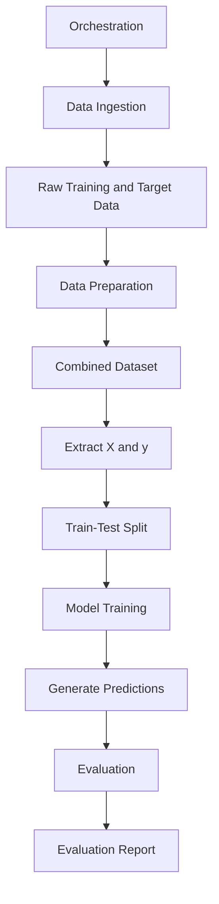

## 5. Orchestration

**Status:** Implemented – Initial Version

### 5.1 Description

The Orchestration module is responsible for coordinating the different components of the GenePert pipeline and managing the execution of the complete workflow.

It connects the Data Ingestion, Data Preparation, Training, and Evaluation modules into a single execution process.

The current implementation provides a central entry point that takes the input data paths, executes each pipeline stage sequentially, and produces an evaluation report.

The module is designed to keep the individual components independent while managing the flow of data between them.

### 5.2 Workflow

The pipeline execution is managed by the `Orch` class through its `run()` method.

1. **Initialization**
   - Receives the paths to the training and target datasets.
   - Initializes the Data Ingestion, Data Preparation, and Trainer components.
   - Initializes the Evaluation component later during execution.

2. **Data Ingestion**
   - Loads the training data and target data.
   - Stores the raw training and target datasets.

3. **Data Preparation**
   - Passes the raw datasets to the Data Preparation module.
   - Builds the combined dataset containing embeddings and mean gene expression profiles.

4. **Data Formatting**
   - Extracts the embedding vectors into the feature matrix `X`.
   - Extracts the gene expression profiles into the target matrix `y`.
   - Converts both matrices into NumPy arrays.

5. **Train-Test Split**
   - Splits the processed data into training and testing datasets.
   - Uses the Trainer component to perform the split.

6. **Model Training**
   - Initializes the selected model.
   - Trains the model using the training datasets.

7. **Prediction**
   - Generates predictions for the training dataset.
   - Generates predictions for the testing dataset.

8. **Evaluation**
   - Extracts the control expression profile from the prepared data.
   - Initializes the Evaluation component.
   - Evaluates both training and testing predictions.

9. **Reporting**
   - Stores the evaluation results.
   - Prints the final evaluation report.

**Workflow overview:**

### 5.3 Inputs

The Orchestration module receives the following inputs:

**Training Data Path (`train_data_path`)**

- Path to the training dataset.
- Contains either precomputed gene embeddings or gene descriptions, depending on the selected ingestion mode.

**Target Data Path (`target_data_path`)**

- Path to the target AnnData dataset.
- Contains the gene expression matrix and associated cell metadata.

**Model (`model`)**

- Name of the model to be used for training.
- Defaults to `"ridge"`.

**Model Parameters (`params`)**

- Intended to contain model-specific configuration parameters.
- Defaults to an empty dictionary.
- Currently not passed to the Trainer during initialization.

### 5.4 Outputs

The Orchestration module stores the intermediate datasets, predictions, and final evaluation report as attributes of the `Orch` class.

**Raw Data**

- `X_raw`: Raw training data loaded through Data Ingestion.
- `y_raw`: Raw target data loaded through Data Ingestion.

**Processed Data**

- `X_processed`: Processed embedding matrix.
- `y_processed`: Processed gene expression matrix.

**Training and Testing Data**

- `X_train`: Training feature matrix.
- `X_test`: Testing feature matrix.
- `y_train`: Training target matrix.
- `y_test`: Testing target matrix.

**Predictions**

- `y_pred_train`: Predictions generated for the training dataset.
- `y_pred_test`: Predictions generated for the testing dataset.

**Evaluation Report**

- `report`: Dictionary containing the evaluation metrics for both training and testing datasets.

### 5.5 Current Implementation

The current implementation connects all four main pipeline components and executes them sequentially through a single `run()` method.

**Data Ingestion**

The `DataIngestion` component loads the training and target datasets using their respective paths.

The resulting datasets are stored as `X_raw` and `y_raw`.

**Data Preparation**

The raw datasets are passed to the `DataPreparation` component, which builds the combined dataset.

The resulting dataset contains:

- Perturbation identifiers.
- Gene embedding vectors.
- Mean gene expression values for each perturbation.

**Feature and Target Extraction**

The combined dataset is converted into two NumPy arrays:

- **X:** Created by stacking the embedding vectors using `np.stack()`.
- **y:** Created by removing the perturbation identifier and embedding columns, then converting the remaining gene expression values into a NumPy array.

**Train-Test Split**

The processed matrices are passed to the Trainer component, which splits the data into training and testing sets.

**Model Training and Prediction**

The Trainer initializes the selected model and fits it using the training data.

Predictions are then generated for both training and testing datasets.

**Evaluation**

The control expression profile is extracted from the prepared control data and converted into a NumPy array.

It is passed to the Evaluation component, which calculates the configured metrics for both training and testing predictions.

**Reporting**

The final evaluation results are stored in the `report` attribute and printed after execution.

### 5.6 Future Enhancements

The Orchestration module is expected to evolve into a more flexible pipeline execution framework.

**Configuration and Flexibility**

- **Model configuration:** Pass model-specific parameters from the orchestration layer to the Trainer.
- **Pipeline configuration:** Allow data preparation settings, training options, and evaluation metrics to be configured externally.
- **Training modes:** Support different training data modes, including loading precomputed embeddings and generating embeddings from gene descriptions.
- **Model selection:** Support different model architectures and model families.

**Execution and Reproducibility**

- **Reproducibility:** Introduce configurable random states for dataset splitting and model training.
- **Error handling:** Introduce centralized error handling to manage failures across pipeline stages.
- **Logging:** Track pipeline execution, intermediate steps, and errors.
- **Validation:** Validate inputs and outputs between pipeline components before proceeding to the next stage.

**Experiment Management**

- **Multiple experiments:** Support running multiple models or configurations within the same pipeline.
- **Experiment tracking:** Track model configurations, metrics, and experiment results.
- **Result persistence:** Save predictions, evaluation reports, and trained models.
- **Model comparison:** Integrate model comparison into the execution workflow.

**Reporting and Visualization**

- **Visualization integration:** Connect the Evaluation module with visualization components.
- **Automated reporting:** Generate structured reports containing evaluation metrics and visualizations.
- **Results management:** Organize experiment outputs in dedicated directories.

### 5.7 Data Types and Object Structure

The Orchestration module manages data passed between the different pipeline components.

**Input Paths (`train_data_path`, `target_data_path`)**

- Python type: `str`.
- Represent the locations of the input datasets.

**Raw Training Data (`X_raw`)**

- Type: Depends on the selected ingestion mode.
- Can be a pandas DataFrame or a dictionary-like embedding object.

**Raw Target Data (`y_raw`)**

- Python type: `anndata.AnnData`.
- Contains the expression matrix, cell metadata, and gene metadata.

**Processed Features (`X_processed`)**

- Python type: `numpy.ndarray`.
- Data type: Typically `float`.
- Expected shape: `(n_perturbations, embedding_dimension)`.
- Each row represents the embedding of one perturbation.

**Processed Targets (`y_processed`)**

- Python type: `numpy.ndarray`.
- Data type: `float`.
- Expected shape: `(n_perturbations, n_genes)`.
- Each row represents the mean gene expression profile of one perturbation.

**Training and Testing Data**

- Python type: `numpy.ndarray`.
- Features and targets are split into four separate arrays.
- Their first dimension represents the number of samples in each split.

**Predictions (`y_pred_train`, `y_pred_test`)**

- Python type: `numpy.ndarray`.
- Data type: Typically `float`.
- Expected shape: `(n_samples, n_genes)`.
- Contains the predicted gene expression profiles.

**Evaluation Report (`report`)**

- Python type: `dict`.
- Top-level keys: `"train"` and `"test"`.
- Values: Dictionaries containing the corresponding evaluation metrics.

### 5.8 Implementation Considerations

The following points should be considered when extending the current implementation:

- The `params` argument is currently not passed to the Trainer. Model-specific parameters are therefore not configurable through the Orchestration constructor yet.
- The train-test split currently uses the default behavior of `train_test_split`, without a fixed random state.
- The control expression profile is extracted separately and passed to the Evaluation module. Its gene ordering must remain consistent with the target expression matrices.
- The current implementation assumes that the processed dataset contains valid embedding vectors that can be stacked into a NumPy array.
- The orchestration currently executes the pipeline sequentially without centralized error handling.
- Pipeline execution and intermediate results are not currently managed through a logging system.
- The evaluation report is printed and stored in memory, but is not automatically saved to disk.
- The `Orch` constructor currently initializes the Trainer with the selected model name but does not expose the full model configuration.
- The current implementation provides an initial end-to-end workflow, but does not yet support multiple experiments or model comparisons within one execution.
