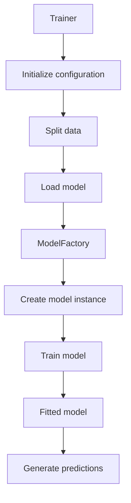

## 3. Training

**Status:** Partially Implemented

### 3.1 Description

The Training module is responsible for managing the model training process, from model initialization to fitting and generating predictions.

It provides a modular structure that separates model creation from the training workflow.

The module currently consists of two main components:

- **Trainer:** Manages the training process, including model initialization, data splitting, model fitting, and prediction.
- **ModelFactory:** Responsible for creating model instances based on the selected model name and its associated parameters.

The current implementation supports Ridge Regression through Scikit-learn.

The long-term objective is to make this module expandable and model-agnostic, allowing different machine learning algorithms and deep learning architectures to be integrated without changing the overall training workflow.

### 3.2 Workflow

The training process is managed by the `Trainer` class.

1. **Initialization**
   - Receives the model name, model parameters, and test dataset size.
   - Stores the configuration required for training.

2. **Data splitting**
   - Uses Scikit-learn's `train_test_split` to divide the input features and targets into training and testing sets.
   - The default test size is 20%.

3. **Model initialization**
   - Calls `ModelFactory` to create the requested model.
   - Passes the model parameters to the corresponding model constructor.

4. **Model training**
   - Initializes the model if it has not already been created.
   - Fits the model using the provided training features and targets.

5. **Prediction**
   - Uses the trained model to generate predictions for new input data.
   - Raises an exception if prediction is requested before model initialization and training.

**Workflow overview:**

### 3.3 Inputs

The module requires the following inputs:

**Training configuration**

The `Trainer` class accepts:

- `model_name`: Identifies the model to be created.
- `model_params`: Dictionary containing model-specific hyperparameters.
- `test_size`: Proportion of the dataset reserved for testing. Defaults to 0.2.

**Training data**

The training process receives two main inputs:

- `X`: Input features, representing the gene embeddings.
- `y`: Target values, representing the corresponding gene expression profiles.

These inputs are expected to come from the Data Preparation module.

**Model configuration**

The `ModelFactory` receives:

- `model_name`: Name of the requested model.
- `kwargs`: Model-specific parameters passed to the model constructor.

Currently, the factory supports:

- `ridge`: Scikit-learn Ridge Regression.

### 3.4 Outputs

The module produces the following outputs:

- **Trained model:** The fitted model instance stored in `self.model`.
- **Predictions:** Output generated by the trained model through the `predict()` method.
- **Data splits:** Training and testing subsets returned by `split_data()`.

The current implementation does not include evaluation metrics or model persistence.

### 3.5 Current Implementation

**Trainer**

The `Trainer` class currently implements the following functionality:

- Stores the selected model configuration.
- Splits input data into training and testing subsets using Scikit-learn.
- Initializes models through `ModelFactory`.
- Trains models using the Scikit-learn `fit()` interface.
- Generates predictions using the model's `predict()` interface.
- Checks whether a model has been initialized before prediction.

**ModelFactory**

The `ModelFactory` class uses a model registry to map model names to their corresponding implementations.

Currently, the registry contains:

- `ridge`: `sklearn.linear_model.Ridge`.

The factory instantiates the selected model and passes the provided parameters to its constructor.

Unsupported model names raise a `ValueError`.

**Base Model Class**

A base model class has been created but is not currently integrated into the training workflow.

Its intended role and interface will be defined as the model architecture becomes more extensible.

### 3.6 Future Enhancements

The Training module is expected to evolve into a modular framework that supports different model architectures and training strategies.

**Model architecture and extensibility**

- **Model abstraction:** Define a common interface for supported models through the existing base model class.
- **Model registry:** Expand `ModelFactory` to support additional machine learning algorithms.
- **Deep learning integration:** Support neural network architectures using frameworks such as PyTorch.
- **Architecture modularity:** Separate model definitions from the training logic to allow new architectures to be added independently.
- **Model configuration:** Standardize how model parameters and architecture configurations are passed to different model implementations.

**Training workflow**

- **Training interface:** Define a consistent training interface that supports both Scikit-learn and deep learning models.
- **Validation set:** Introduce a validation dataset for hyperparameter tuning and model selection.
- **Reproducibility:** Add random state configuration to ensure reproducible data splitting and training.
- **Training configuration:** Move training parameters into a configurable structure.
- **Training monitoring:** Track training progress, losses, and other relevant training information.
- **Early stopping:** Support early stopping for iterative training algorithms and neural networks.
- **Batch training:** Introduce mini-batch training support for deep learning models.

**Model evaluation**

- **Evaluation module:** Introduce a dedicated component for evaluating model performance.
- **Metrics:** Implement suitable regression metrics such as:
  - Mean Squared Error (MSE).
  - Root Mean Squared Error (RMSE).
  - Mean Absolute Error (MAE).
  - R-squared (R²).
- **Multi-output evaluation:** Define how predictions across multiple genes should be evaluated.
- **Model comparison:** Support comparing different models and configurations.

**Model management**

- **Model persistence:** Save and load trained models.
- **Experiment tracking:** Track model configurations, hyperparameters, and performance results.
- **Checkpointing:** Support saving intermediate model states, particularly for deep learning models.
- **Model versioning:** Keep track of trained model versions and their configurations.

### 3.7 Data Types and Object Structure

The Training module receives input features and targets from Data Preparation and produces a fitted model and predictions.

**Input Features (`X`)**

- Expected type: `pandas.DataFrame` or compatible array-like structure.
- Expected content: Gene embeddings.
- Each sample represents a perturbation gene.
- Each sample contains an embedding vector.

**Target Values (`y`)**

- Expected type: `pandas.DataFrame` or compatible array-like structure.
- Expected content: Mean gene expression profiles.
- Each row corresponds to a perturbation.
- Each column represents a gene expression target.

**Data Splits**

Generated by `split_data()`:

- `X_train`: Training features.
- `X_test`: Testing features.
- `y_train`: Training targets.
- `y_test`: Testing targets.

The returned objects preserve the input container type when supported by Scikit-learn.

**Model Configuration**

- `model_name`: `str`.
- `model_params`: `dict`.
- `test_size`: `float`.

**Model Instance (`self.model`)**

- Type: Depends on the selected model implementation.
- Current implementation: `sklearn.linear_model.Ridge`.
- Initialized through `ModelFactory`.

**Predictions**

- Generated by the model's `predict()` method.
- Expected type for Ridge Regression: `numpy.ndarray`.
- Expected shape: Number of input samples × Number of target genes for multi-output regression.

**ModelFactory**

- `models`: Python `dict` mapping model names (`str`) to model classes.
- `create_model()`: Returns an instantiated model object.

**Base Model Class**

- Exists in the project but is not currently used by `Trainer` or `ModelFactory`.
- Its final interface and responsibilities are yet to be defined.

### 3.8 Implementation Considerations

The following points should be considered when extending the current implementation:

- The current `split_data()` method is implemented but is not automatically called by `train()`. Data splitting and model fitting must currently be orchestrated externally.
- The current `train()` method fits the model using the entire dataset passed to it.
- No random state is configured for data splitting.
- No validation dataset is currently created.
- The current model factory supports only Ridge Regression.
- The existing base model class is not integrated into the factory or trainer.
- The current training workflow relies on the Scikit-learn `fit()` and `predict()` interfaces, which will require an abstraction or adapter strategy when introducing deep learning models.
- No model evaluation, persistence, or experiment tracking is currently implemented.
