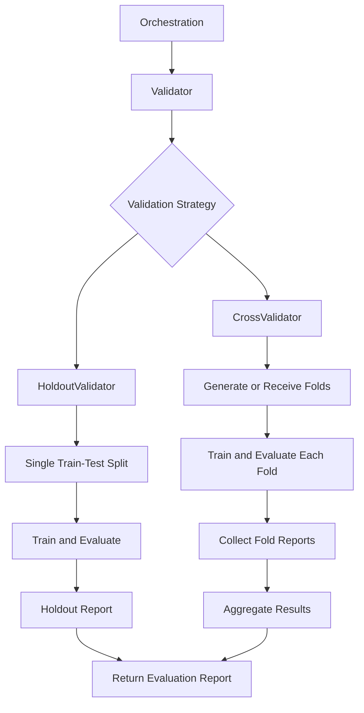

## 6. Validation

**Status:** Implemented – Initial Version

### 6.1 Description

The Validation module is reponsible for coordinating the traing and evealuation of models according to a selected validation strategy.

It connects the Training and Evaluation modules and manages the process of splitting the prepared dateset, training models, generating predictions, and collecting evealuation results.

The current implementation supports two validation strategies:

- **Holdout validation:** Splits the dataset into a single training and testing dataset.
- **K-fold cross-validation:** Divides the dataset into multiple folds and evaluates model performance across each fold.

The module also supports externally provided folds, allowing multiple experiments to be evaluated using identical training and testing partitions.

The module is designed to keep validation logic independent of the Orchestration, Training, and Evaluation modules while providing a consistent entry point for executing different validation strategies.

### 6.2 Workflow

The validation process is managed by the `Validator` class through its `run()` method.

1. **Initialization**
   - Receives an initialized Trainer component.
   - Receives the selected validation method and configuration parameters.

2. **Strategy Selection**
   - Selects the appropriate validation class.
   - Initializes either `HoldoutValidator` or `CrossValidator`.

3. **Data Splitting**
   - Receives the processed feature matrix, target matrix, and control expression profile.
   - Creates training and testing partitions according to the selected validation strategy.
   - Uses externally provided folds when available for cross-validation.

4. **Model Training**
   - Initializes a fresh model for each training partition.
   - Trains the model using the Trainer component.

5. **Prediction**
   - Generates predictions for the training dataset.
   - Generates predictions for the testing dataset.

6. **Evaluation**
   - Passes the observed and predicted expression profiles to the Evaluation module.
   - Collects training and testing metrics.

7. **Reporting**
   - Returns the evaluation report for holdout validation.
   - Collects individual fold reports for cross-validation.
   - Calculates the mean and sample standard deviation of each metric across valid folds.
   - Returns the final report to the Orchestration module.

**Workflow overview:**

### 6.3 Inputs

**Feature Matrix (`X`)**

- Contains the embedding vectors associated with each perturbation.
- Each row represents a perturbation.
- Each column represents an embedding dimension.

**Target Matrix (`y`)**

- Contains the experimentally observed mean gene expression profiles.
- Each row corresponds to a perturbation in the feature matrix.
- Each column represents a measured gene.

**Control Mean (`ctrl`)**

- Contains the mean expression profile of the control cells.
- Used by the Evaluation module to calculate control-relative metrics.
- Must follow the same gene ordering as the target matrix.

**Perturbation IDs (`ids`)**

- Contains the identifiers associated with each perturbation.
- Required for cross-validation.
- Used to record the perturbations assigned to each training and testing fold.
- Must follow the same row ordering as the feature and target matrices.

**Trainer (`trainer`)**

- An initialized Trainer instance.
- Contains the selected model and model-specific configuration parameters.
- Used to initialize, train, and generate predictions with the model.

**Validation Method (`method`)**

- Defines the validation strategy to be used.
- Supports `"holdout"` and `"cross_validation"`.
- Defaults to `"holdout"`.

**Number of Splits (`n_splits`)**

- Defines the number of folds used during cross-validation.
- Defaults to `5`.

**Shuffle (`shuffle`)**

- Determines whether the data is shuffled before generating cross-validation folds.
- Defaults to `True`.

**Random State (`random_state`)**

- Controls the reproducibility of generated cross-validation partitions when shuffling is enabled.
- Defaults to `42`.

**Shared Folds (`folds`)**

- Optional collection of externally generated training and testing indices.
- Allows multiple experiments to use identical data partitions.
- If no folds are provided, the CrossValidator generates its own folds.

### 6.4 Outputs

The Validation module returns a structured dictionary containing the evaluation results.

**Holdout Validation**

The holdout validation report maintains the existing Evaluation module report structure.

- `train`: Evaluation metrics calculated on the training dataset.
- `test`: Evaluation metrics calculated on the testing dataset.

**Cross-Validation**

The cross-validation report contains the validation configuration, individual fold results, and aggregated performance metrics.

- `mode`: Selected validation method.
- `n_splits`: Number of folds executed.
- `fold_source`: Indicates whether the folds were generated internally or provided externally.
- `shuffle`: Shuffle configuration for internally generated folds.
- `random_state`: Random state used for internally generated shuffled folds.
- `folds`: Individual fold reports.
- `summary`: Aggregated training and testing metrics.

Each individual fold report contains:

- `fold`: Fold number.
- `train_ids`: Perturbation identifiers included in the training partition.
- `test_ids`: Perturbation identifiers included in the testing partition.
- `report`: Training and testing evaluation metrics.

For each evaluation metric, the aggregated summary contains:

- `mean`: Mean metric value across valid folds.
- `std`: Sample standard deviation across valid folds.
- `n_valid`: Number of folds containing finite values for the metric.

Non-finite metric values are excluded from aggregation. The standard deviation is undefined when fewer than two valid fold values are available.

### 6.5 Implementation

The Validation module is implemented through three classes.

**Validator (`validation.py`)**

Responsible for coordinating the validation process and selecting the appropriate validation strategy.

Methods:

- `__init__()`: Initializes the Trainer reference and validation configuration.
- `select_strategy()`: Initializes and returns the selected validation class.
- `run()`: Executes the selected validation strategy and returns its evaluation report.

**HoldoutValidator (`holdout.py`)**

Responsible for executing a single training and testing split.

Methods:

- `__init__()`: Initializes the Trainer reference.
- `run()`: Splits the dataset, initializes and trains the model, generates predictions, and returns the evaluation report.

The HoldoutValidator uses the existing `split_data()` method provided by the Trainer component.

**CrossValidator (`cross_validation.py`)**

Responsible for executing K-fold cross-validation and aggregating evaluation results.

Methods:

- `__init__()`: Initializes the Trainer reference and cross-validation configuration.
- `split_folds()`: Generates training and testing indices using scikit-learn's KFold implementation.
- `run_fold()`: Executes model training, prediction, and evaluation for an individual fold.
- `aggregate_results()`: Calculates the mean, sample standard deviation, and number of valid folds for each evaluation metric.
- `run()`: Coordinates the execution of all folds, records perturbation assignments, and returns the complete cross-validation report.

### 6.6 Current Limitations and Future Enhancements

**Shared Fold Alignment**

Externally provided folds are based on positional indices. Therefore, experiments using shared folds must contain the same perturbations in the same row ordering.

The current implementation assumes that externally provided folds are valid and correctly aligned.

**Data Preprocessing**

Data preparation is performed before the validation process. Consequently, dataset-dependent preprocessing operations may incorporate information from perturbations that are subsequently assigned to testing folds.

Future implementations may introduce fold-specific preprocessing to reduce potential data leakage.

**Model Persistence**

A fresh model is initialized for each cross-validation fold. After cross-validation, the Trainer retains the model trained during the final fold.

Training a final model on the complete dataset would require an additional training step.

**Additional Validation Strategies**

The modular structure allows additional validation strategies to be implemented independently.

Potential extensions include:

- Nested cross-validation.
- Additional data splitting strategies.
- Fold-specific data preprocessing.

**Multiple Experiment Evaluation**

The support for shared folds provides a foundation for comparing multiple models and model configurations under consistent validation conditions.

The coordination of multiple experiments and the comparison of their evaluation reports remain responsibilities of the Orchestration and Evaluation modules.